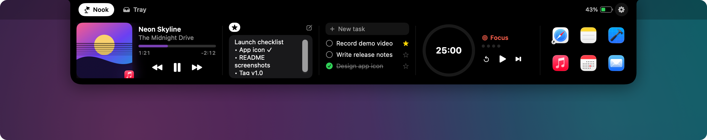
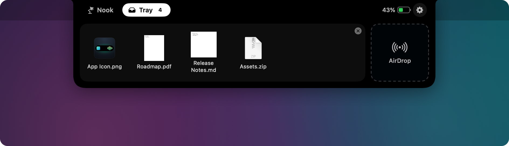
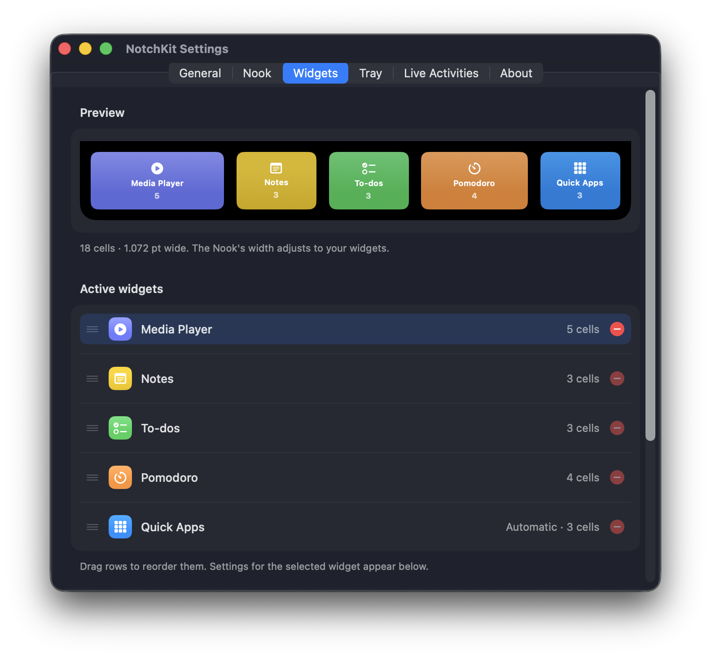

<p align="center">
  
</p>

<h1 align="center">NotchKit</h1>

<p align="center">
  An open-source macOS app, built with SwiftUI, that turns your MacBook's notch into a home for widgets.<br>
  Music, calendar, notes, to-dos, Pomodoro and files, right at the top of your screen.
</p>

<p align="center">
  
</p>

---

## Features

### The Nook: widgets in your notch

Hover over or click the notch, or swipe down with two fingers, to open it. It closes when you move the pointer away or click outside. The notch grows to fit the widgets you pick.

| Widget | What it does |
|---|---|
| **Media player** | System-wide Now Playing (Spotify, Apple Music, browsers…) with album art, a draggable progress bar and playback controls |
| **Calendar** | Day strip, your events, and a **Join** button for Google Meet, Zoom, Teams and Webex links |
| **Pomodoro** | Focus, short break and long break cycles, with session dots and a sound at the end of each phase |
| **Notes** and **To-dos** | Quick notes and a task list with favorites |
| **Quick Apps** | Pin your favorite apps and launch them in one click. A dot marks apps that are running |
| **Shortcuts** | Run shortcuts from the macOS Shortcuts app |
| **Mirror** | Use your camera as a mirror |

### Live activities

While the notch is closed, small indicators appear on either side of it: the track that's playing (album art and audio bars), the Pomodoro countdown, charging status, your next event and the number of files in the tray.

<p align="center">
  
  
</p>

### Tray

Drag files onto the notch to keep them in a tray, or drop them on the AirDrop target to share them. Files stay in the tray between restarts.

<p align="center">
  
</p>

### Settings

Add, remove and reorder widgets with a live preview, and configure each widget on its own.

With more than one display connected, choose where the notch appears: all displays, only the built-in display, only the main display, or the displays you pick.

<p align="center">
  
</p>

### Gestures

- Swipe down on the notch to open it, and swipe up to close it.
- Swipe sideways on the notch to skip to the next or previous track.
- Right-click the notch to open Settings or quit.

### Languages

NotchKit is available in **English** and **Turkish**. It follows your Mac's language by default (Turkish if your Mac is set to Turkish, English otherwise), and you can switch it in **Settings → General → Language**.

## Install

1. Download the latest **NotchKit-x.y.z.dmg** from [Releases](https://github.com/yunusemrekorucu/notchkit/releases/latest) and open it.
2. Drag **NotchKit** to **Applications**.
3. Open NotchKit. Because the app isn't notarized yet, macOS blocks the first launch. Go to **System Settings → Privacy & Security** and click **Open Anyway** next to the NotchKit message. You only need to do this once.

   If you prefer the Terminal, this removes the download quarantine instead:

   ```bash
   xattr -dr com.apple.quarantine /Applications/NotchKit.app
   ```

NotchKit runs on macOS 14.6 or later, natively on both Apple silicon and Intel Macs.

## Building from source

### Requirements

- macOS 14.6 or later (a MacBook with a notch is recommended; screens without a notch get a virtual one)
- Xcode 16 or later
- [XcodeGen](https://github.com/yonaskolb/XcodeGen) and [CMake](https://cmake.org)

```bash
brew install xcodegen cmake
```

### Build

```bash
git clone --recursive https://github.com/yunusemrekorucu/notchkit.git
cd notchkit
xcodegen generate
open NotchKit.xcodeproj
```

Or build from the command line:

```bash
xcodebuild -project NotchKit.xcodeproj -scheme NotchKit -configuration Release -derivedDataPath build/DD build
```

The media bridge (`vendor/mediaremote-adapter`) is built automatically on the first build. The app is produced as `NotchKit.app`; copy it to `/Applications` and open it.

If you cloned without `--recursive`, fetch the submodule with `git submodule update --init`.

### Release DMG

`scripts/build-release.sh` builds a universal app and packages it as `build/release/NotchKit-<version>.dmg`. Pushing a tag such as `v1.1.0` runs the same script on GitHub Actions and attaches the DMG to a release. Release notes are read from `docs/release-notes/<tag>.md` when that file exists.

### Demo mode

Launch with `-demo YES` to show a sample track instead of your real media, which is handy for screenshots:

```bash
open -a NotchKit --args -demo YES
```

## Permissions

NotchKit asks for each permission only the first time you use the feature that needs it.

| Permission | Used for |
|---|---|
| Calendars | The Calendar widget and the upcoming-event indicator |
| Camera | The Mirror widget |
| Automation (Apple Events) | Media controls |

## How it works

- Each enabled display gets a full-width, transparent `NSPanel` at the status bar level. The notch is drawn inside it with SwiftUI and animates between its closed and open shapes.
- Now Playing data comes from Apple's private MediaRemote framework. Since macOS 15.4 restricts direct access, NotchKit uses the open-source [mediaremote-adapter](https://github.com/ungive/mediaremote-adapter).
- Settings are stored with [Defaults](https://github.com/sindresorhus/Defaults), and launch at login uses [LaunchAtLogin](https://github.com/sindresorhus/LaunchAtLogin-Modern).

## Project structure

```
App/Sources
├── App/             App entry point and the Settings window
├── Notch/           Panel, notch shape, state, pointer and drag tracking
├── Nook/            Widgets (media, calendar, Pomodoro, notes…)
├── Tray/            File tray and AirDrop
├── LiveActivities/  Closed-notch indicators and battery monitoring
├── Media/           Bridge to mediaremote-adapter
├── Settings/        Settings screens
└── Shared/          Settings keys and helpers
App/Resources        App icon and string catalogs (English, Turkish)
design/AppIcon.svg   Source of the app icon
scripts/             Release build script
docs/screenshots     Images used in this README
```

## License

[MIT](LICENSE). `vendor/mediaremote-adapter` is distributed under its own license (BSD-3-Clause).

NotchKit is an independent project and is not affiliated with any commercial notch app.
