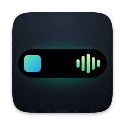
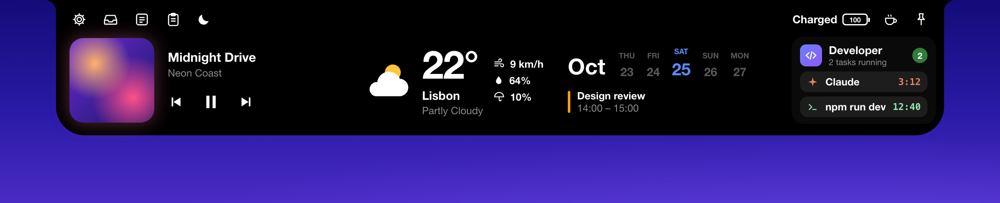

<p align="center">
  
</p>

<h1 align="center">NotchKit</h1>

<p align="center">
  A free, open-source macOS app that turns your MacBook's notch into a home for widgets, live activities and system tools.
</p>

<p align="center">
  
</p>

<p align="center">
  
  
  
</p>

<p align="center"><sub>Screenshots use sample data.</sub></p>

---

## What's in NotchKit 2

NotchKit 2 is rebuilt on [Sapphire](https://github.com/cshariq/Sapphire): a notch that morphs smoothly between states, more widgets and a large set of system tools. Everything that needs a paid service, an AI API or a paid Apple Developer account was left out, so nothing in the app costs money to run.

### Notch and widgets

Click the notch (or hover, if **Expand on Hover** is on) to open it. Swipe to switch pages, and use the icons along the top for settings, the file shelf, notes, clipboard history and Focus. Typing works right inside the notch, so notes and search fields take keyboard input without opening a window.

| Widget | What it does |
|---|---|
| **Music** | System-wide Now Playing with artwork, controls, a media source switcher and synced lyrics from [LRCLIB](https://lrclib.net) |
| **Weather** | Current conditions and an hourly forecast from [Open-Meteo](https://open-meteo.com), with no API key |
| **Calendar** | Day strip, events and reminders |
| **Developer** | Running AI agents, builds and dev servers, with usage and a built-in terminal (see below) |
| **Focus** | Focus sessions with streaks, app and website blocking |
| **Pomodoro** | Focus, short break and long break cycles with session dots |
| **To-dos** | A quick task list with stars |
| **Quick Apps** | Pinned apps you open in one click; a dot marks running apps |
| **Timer**, **Notes**, **Clipboard**, **Shortcuts**, **Mirror**, **Battery** | Timers and stopwatch, rich-text notes, clipboard history, Shortcuts, camera mirror and battery details |

### Live activities

While the notch is closed, it shows what's going on: the track that's playing, the weather, timers and Pomodoro, Focus, battery and charging, calendar events, file transfers, Bluetooth connections, desktop switches, eye-break reminders and more.

Whenever a live activity is showing, a **home bubble** sits beside the notch. Click it to jump straight to your widgets. Side bubbles grow with the notch when you hover over it.

### Developer panel

The Developer widget follows what's running on your Mac while you code:

- **Activity**: AI coding agents (Claude, Codex, Cursor, Gemini, Copilot, Aider, OpenCode and others), builds (Xcode, Gradle, Swift, Cargo, Go, Flutter, Make) and dev servers, each with its run time, CPU, memory, folder and Git branch. Open a task to read the agent's conversation or its processes, send it a message, interrupt it or jump to its terminal.
- **Usage**: plan limits and daily usage for your AI tools
- **Terminal**: run commands in a project folder and keep their output

In the closed notch, a running task shows as a compact activity with its own side bubble.

### Proximity unlock

Pick your iPhone or another Bluetooth device as a trusted device, and NotchKit locks your Mac when you walk away and unlocks it when you come back. **Calibrate Range** measures the signal where you sit and where you want the Mac to lock, and suggests both thresholds. Your Mac password is checked with macOS before it's saved, and stays encrypted in your keychain.

### System tools

- **Snap Zones**: drag windows into custom zones, with keyboard shortcuts
- **HUD**: volume and brightness overlays that replace the system ones
- **Clipboard history**, **Caffeinate**, **Eye Break** (20-20-20), **File Shelf** with AirDrop
- **Lock screen** widgets, **menu bar** item management, **Launchpad**
- **App activities** for Zoom, Meet, Teams and others, and **file progress** for downloads and copies
- **Displays**: show the notch on every display, only the built-in one, only the main one, or the ones you pick

### Left out on purpose

Gemini Live, Blip and other AI features, sports, finance and Shopify widgets, Nearby Share, phone continuity, the virtual audio driver, the camera extension, Face ID unlock, Spotify/TIDAL account login and analytics.

## Install

1. Download the latest **NotchKit-x.y.z.dmg** from [Releases](https://github.com/yunusemrekorucu/notchkit/releases/latest) and open it.
2. Drag **NotchKit** to **Applications**.
3. Open NotchKit. Because the app isn't notarized, macOS blocks the first launch. Go to **System Settings → Privacy & Security** and click **Open Anyway** next to the NotchKit message. You only need to do this once.

   If you prefer the Terminal, this removes the download quarantine instead:

   ```bash
   xattr -dr com.apple.quarantine /Applications/NotchKit.app
   ```

NotchKit runs on macOS 14.6 or later, natively on both Apple silicon and Intel Macs. It's available in English and Turkish: it follows your Mac's language, or you can pick one under **Settings → General → Language**.

Upgrading from NotchKit 1.x keeps your to-dos, pinned Quick Apps and Pomodoro durations, and turns on the widgets you had enabled.

## Building from source

### Requirements

- Xcode 26 or later
- [XcodeGen](https://github.com/yonaskolb/XcodeGen)

```bash
brew install xcodegen
```

### Build

```bash
git clone https://github.com/yunusemrekorucu/notchkit.git
cd notchkit
xcodegen generate
open NotchKit.xcodeproj
```

Or build from the command line:

```bash
xcodebuild -project NotchKit.xcodeproj -scheme NotchKit -configuration Release -derivedDataPath build/DD build
```

The app is produced as `NotchKit.app`; copy it to `/Applications` and open it.

### Release DMG

`scripts/build-release.sh` builds a universal app and packages it as `build/release/NotchKit-<version>.dmg` (it also needs `brew install create-dmg`). Pushing a tag such as `v2.0.0` runs the same script on GitHub Actions and attaches the DMG to a release. Release notes are read from `docs/release-notes/<tag>.md` when that file exists.

### README screenshots

The images in `docs/screenshots` are mockups built from `docs/screenshots/mock/notch.html` with sample data, so they never show what's on the Mac that made them. After changing the page, run `scripts/render-readme-mocks.sh` (it needs Google Chrome) to render them again.

### Translations

User-facing text lives in `App/Resources/Localizable.xcstrings` (and permission prompts in `InfoPlist.xcstrings`). Xcode adds new string literals from SwiftUI views and `String(localized:)` to the catalog when you build; titles passed around as plain `String` values are looked up at display time through the helpers in `App/Sources/App/Localization.swift`, so add those keys to the catalog by hand.

## Permissions

NotchKit walks you through permissions on first launch. Each one only powers the features listed.

| Permission | Used for |
|---|---|
| Accessibility | Media keys, Snap Zones, the HUD and typing your password for proximity unlock |
| Bluetooth | Connection notices, device batteries and proximity unlock |
| Location | Local weather |
| Calendars and Reminders | Calendar widget and event activities |
| Camera | Mirror widget |
| Automation (Apple Events) | Controlling Music and Spotify |
| Screen Recording | Per-app audio capture and menu bar tinting |

## Project structure

```
App/
├── Sources/          Swift sources
│   ├── Notch/        Notch window, shape, morph animation and layout
│   ├── Widgets/      Widget views
│   ├── Services/     Music, weather, calendar, zones, menu bar, lock screen and more
│   ├── App Settings/ Settings window
│   └── Stubs/        No-op stand-ins for features NotchKit does not ship
├── ObjC/             Objective-C helpers and the bridging header
├── PrivateHeaders/   Private framework headers
└── Resources/        Asset catalog and string catalogs
docs/
├── release-notes/    Notes attached to each GitHub release
└── screenshots/      README images and the mock page they're rendered from
scripts/              Release DMG and screenshot scripts
```

## Credits and license

NotchKit 2 is a fork of [Sapphire](https://github.com/cshariq/Sapphire), Copyright © Shariq Charolia, licensed under the GNU Affero General Public License v3.0. NotchKit's own code is Copyright © 2026 Yunus Emre Korucu and is released under the same license.

NotchKit is distributed under the [GNU AGPL v3.0](LICENSE). See [NOTICE.md](NOTICE.md) and [CREDITS.md](CREDITS.md) for the third-party components Sapphire includes.
